<div align="center">

# CQA — Conversation Quality Analytics · команда Bolme

**ИИ проверяет каждый диалог оператора по чек-листу прямо в Dynamics 365. У каждого балла есть объяснение и реплика-доказательство.**

<a href="#точность"></a>
<a href="#точность"></a>
<a href="#точность"></a>
<a href="#модели-и-стоимость"></a>
<br>


[Демо](#демо-и-доступ-для-жюри) ·
[2 слайда (PDF)](docs/presentation.pdf) ·
[проверка за 3 минуты](#проверка-за-3-минуты) ·
[разбор задания](docs/TASK.md) ·
[список фич](docs/FEATURES.md) ·
[контрольный прогон](docs/CONTROL_RUNBOOK.md)

</div>

---

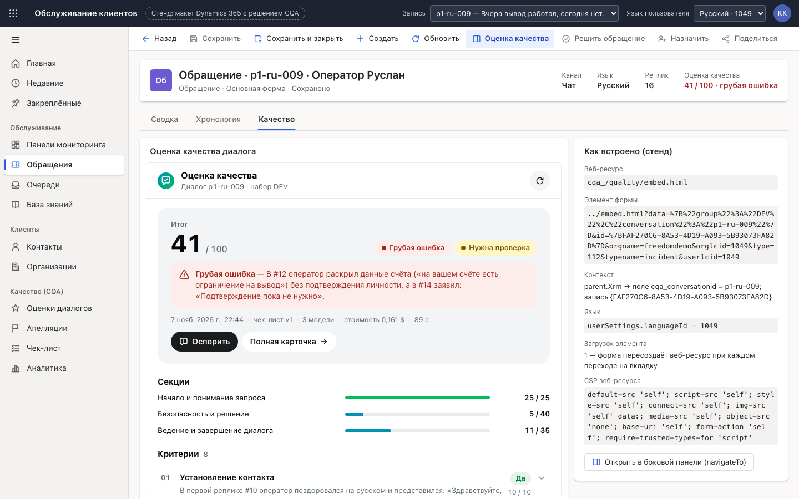

Кейс **Freedom Broker** на хакатоне **Data Challenge'26** (Nazarbayev University, Астана, 7–8 ноября 2026).

## Демо и доступ для жюри

| | |
| --- | --- |
| **Демо** | **https://cqa-datachallenge26.vercel.app/d365/** — откроется Dynamics 365 с разделом «Качество (CQA)» |
| **Логин** | `jury` |
| **Пароль** | `Bolme-CQA-0811` |
| **Отдельное приложение** | https://cqa-datachallenge26.vercel.app/ — тот же продукт без оболочки Dynamics |
| **Браузер** | Chrome, Edge или Safari, экран от 1280 px |

В демо уже лежат реальные оценки всех 60 чатов DEV. Кнопка «Оценить» запускает настоящую оценку моделями: около 30 секунд и $0,155 за диалог. Локально (`uv run uvicorn app.main:app`) входа нет.

## Итог за 30 секунд

Оператора оценивают по чек-листу из 8 критериев. Мы не просим модель «поставить балл»: каждый ответ можно проверить, а итог считает код, не модель.

| Что важно | Результат |
|---|---|
| Совпадение с экспертной разметкой, 60 чатов RU/KZ/EN, 480 ответов | **95,8%** |
| То же на 20 отложенных чатах, не использованных при настройке | **93,1%** |
| Грубые ошибки (критерий 08) | **совпали с эталоном во всех 60 чатах, ложных срабатываний нет** |
| Стоимость и время одной оценки | **$0,155, около 30 секунд** |
| Где работает | **внутри Dynamics 365**: раздел «Качество» в карте сайта, вкладка «Качество» в форме обращения |

**Что внутри — три идеи:**

1. **Отдельный запрос на каждый критерий.** Ответ — строгий JSON: применимость → доказательства → рассуждение → вердикт. Номер реплики-доказательства код сверяет с транскриптом; неподтверждённая цитата уходит в «нужна проверка».
2. **Три модели голосуют.** Claude Opus 5.5, GLM-5.3 и Qwen 3.8: большинство, для шкалы медиана. Расхождение — сигнал проверяющему, а не случайный балл.
3. **Чек-лист — данные, а не код.** Новый критерий из редактора оценивается сразу. Переоценка набора по новой версии пересчитывает только изменённые критерии.

<p align="center">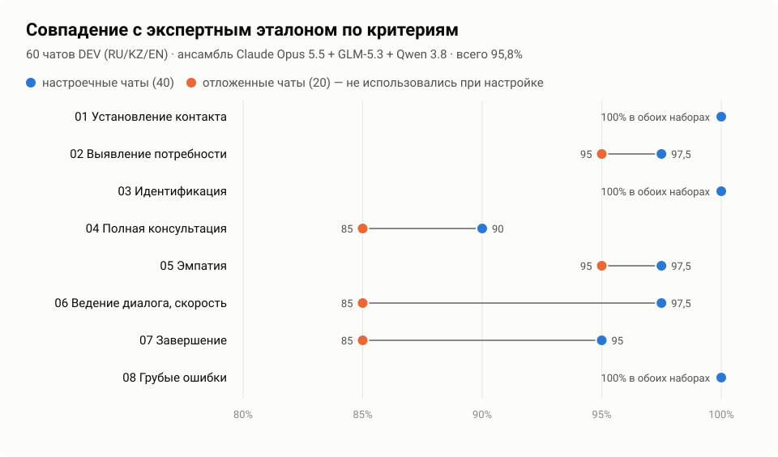</p>

**Навигация:**
[Проверка за 3 минуты](#проверка-за-3-минуты) ·
[Возможности](#возможности) ·
[Как устроена оценка](#как-устроена-оценка) ·
[Точность](#точность) ·
[Модели и стоимость](#модели-и-стоимость) ·
[Как поменять чек-лист](#как-поменять-чек-лист) ·
[Dynamics 365](#dynamics-365) ·
[Архитектура](#архитектура) ·
[Запуск](#запуск) ·
[API](#api)

## Проверка за 3 минуты

1. **Откройте демо и войдите:** `jury` / `Bolme-CQA-0811`. Откроется Dynamics 365 на экране **«Качество (CQA) → Оценки диалогов»**.
2. **Фильтр «Грубая ошибка».** 8 диалогов, у каждого объяснение с номером реплики прямо в списке.
3. **Строка `p1-ru-009`** → форма обращения на вкладке «Качество». В шапке записи «41 / 100 · грубая ошибка», ниже секции и 8 критериев: ответ, баллы, объяснение, цитата. Клик по `#12` открывает транскрипт на этой реплике.
4. **«Оспорить»** → критерий «08 Грубые ошибки» → комментарий. У «Апелляций» в карте сайта появляется счётчик.
5. **«Апелляции» → «Я — проверяющий» → «Изменить ответ»** с причиной. Итог и отметка о грубой ошибке пересчитываются, в карточке видно «было → стало», шапка формы обновляется.
6. **«Чек-лист» → «Изменить чек-лист».** Поменяйте вес или замените критерий — итог справа пересчитывается сразу. «Сохранить как новую версию» → «Переоценка набора»: заново оцениваются только изменённые критерии, решения проверяющего сохраняются, таблица «итог до → после».
7. **«Аналитика».** Точность по критериям, языкам и отложенным чатам; «где ломается сценарий» с цитатами.
8. **«Язык пользователя → Қазақша»** на форме: панель оценки на казахском.

Данные демо общие для всех, кто зашёл: апелляции и новые версии чек-листа видят все.

<p align="center">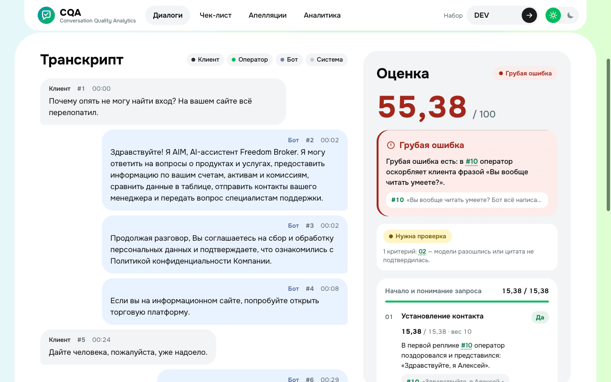</p>

## Возможности

### Внутри Dynamics 365

| Оценки диалогов в карте сайта | Вкладка «Качество» в форме обращения |
| --- | --- |
| 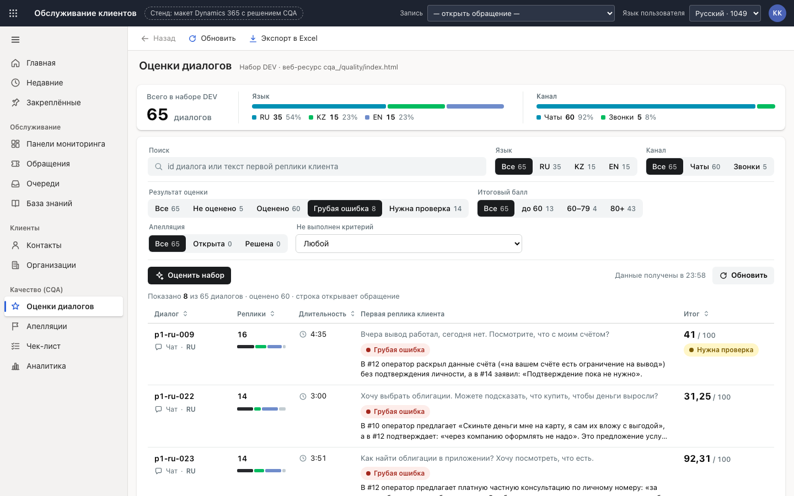 |  |
| **Апелляция и решение проверяющего** | **Боковая панель на казахском** |
| 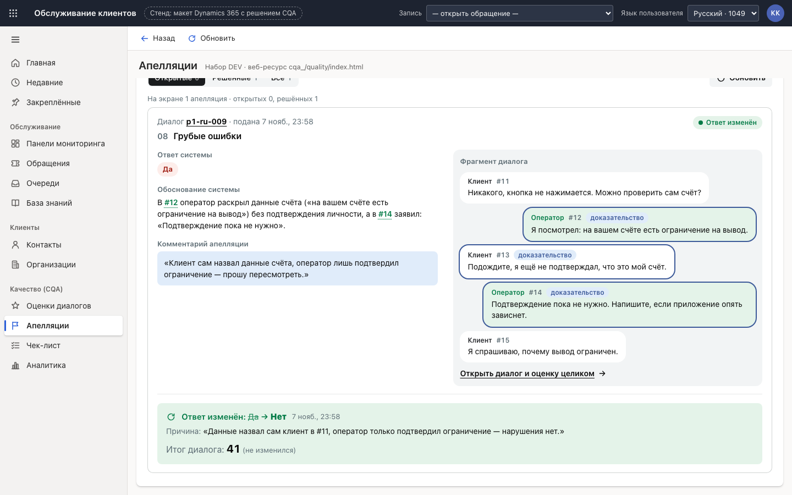 | 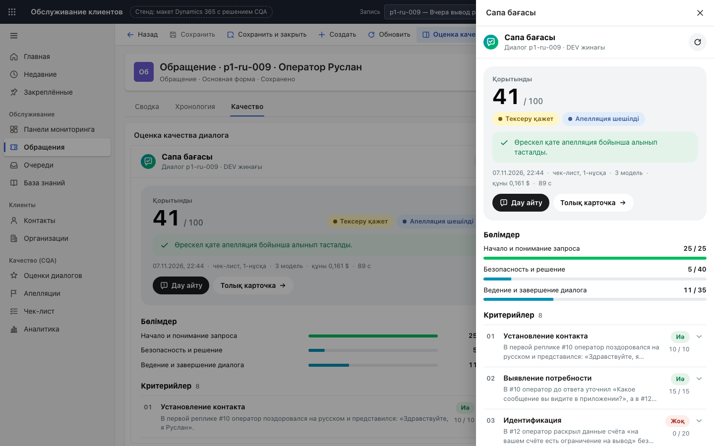 |

- **Весь продукт в оболочке model-driven app.** Карта сайта «Качество (CQA)»: «Оценки диалогов», «Апелляции» (со счётчиком открытых), «Чек-лист», «Аналитика». Строка списка открывает запись «Обращение» через `Xrm.Navigation.openForm`, переходы между экранами идут через `navigateTo`, «Назад» работает как в Dynamics.
- **Вкладка «Качество» и боковая панель.** Контекст записи и язык пользователя берутся из `parent.Xrm`, после решения по апелляции шапка формы обновляется через `formContext.data.refresh`.
- **Те же файлы работают отдельно** — на `/` открывается самостоятельное приложение.

### Карточка диалога: каждый балл с доказательством

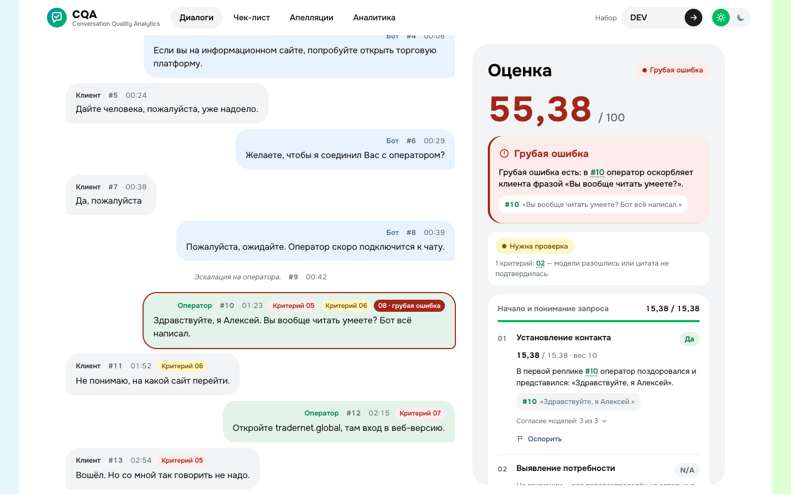

| Клик по доказательству | Апелляция: было → стало |
| --- | --- |
| 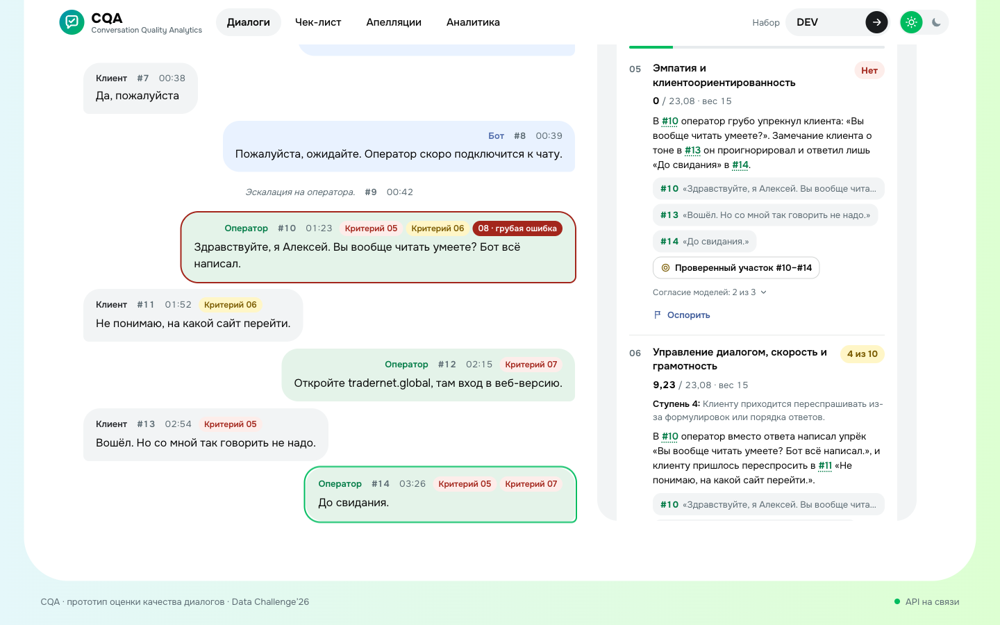 | 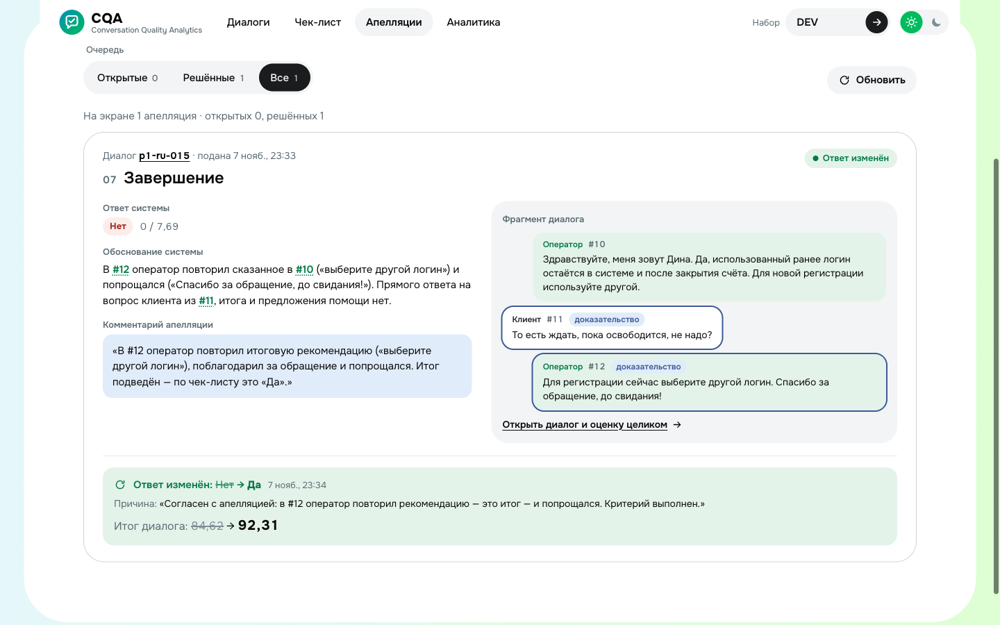 |

- По каждому критерию: ответ, баллы и вес, объяснение со ссылками `#N` на реплики, цитата. Для невыполненного действия — проверенный участок диалога, для N/A — причина неприменимости.
- Грубая ошибка — отдельный баннер с цитатой, без баллов. Согласие моделей, стоимость, время и версия чек-листа видны в карточке.
- Расхождение моделей или неподтверждённая цитата → «Нужна проверка» и отдельный фильтр в списке.

### Чек-лист и переоценка

| Редактор с живым пересчётом | Переоценка набора по новой версии |
| --- | --- |
| 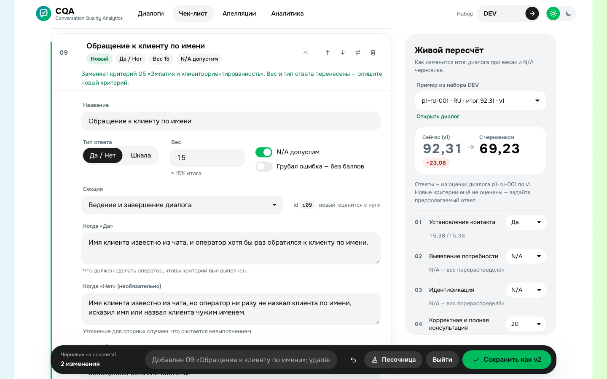 | 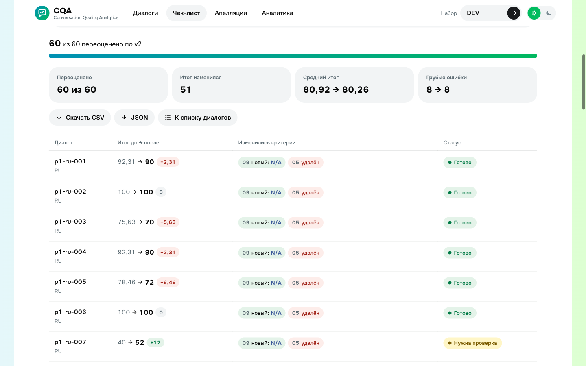 |

- Добавить, удалить, переставить или заменить критерий; вес, тип ответа (Да/Нет или шкала), N/A, условия, указания для ИИ. Версии неизменяемы, любые две можно сравнить.
- Песочница: черновик критерия проверяется на размеченных чатах без изменения действующей версии.

### Аналитика

| Точность против эталона | Где ломается сценарий |
| --- | --- |
| 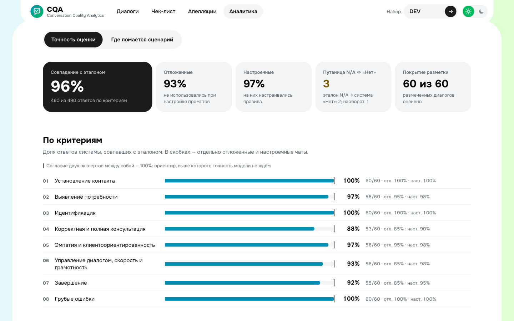 | 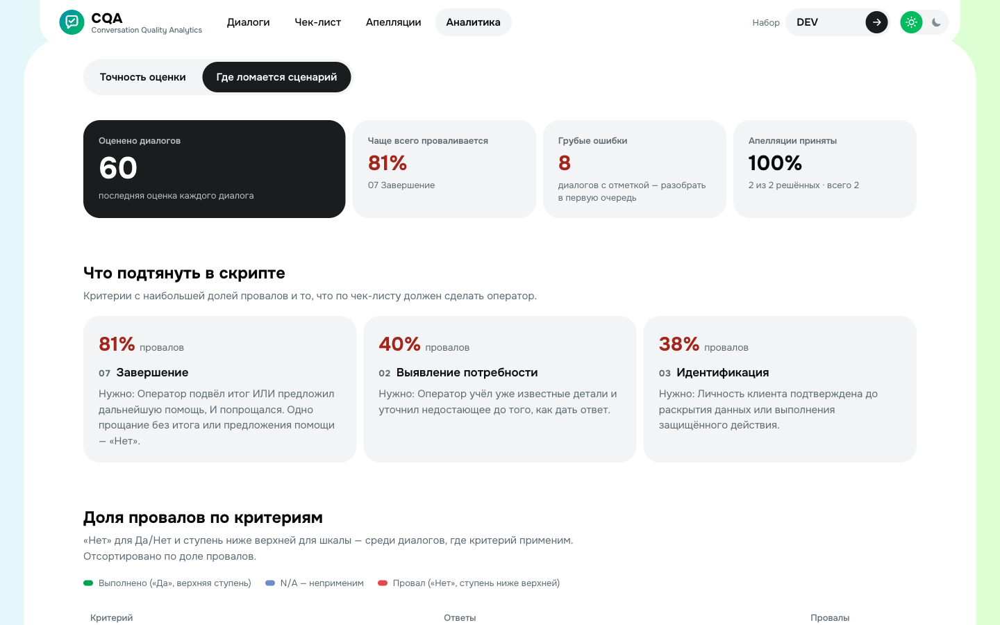 |

Ещё: пакетная оценка (все, отфильтрованные или неоценённые) с прогрессом и остановкой, экспорт JSON/CSV, плеер звонков с переходом к фрагменту из обоснования, интерфейс панели на RU/KZ/EN, светлая и тёмная темы.

## Как устроена оценка

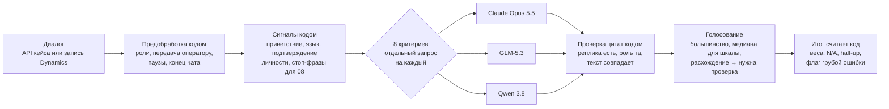

1. **Предобработка кодом.** Нумерованный транскрипт, роли, момент передачи чата оператору, время первой реакции, паузы, конец чата. Оценивается только оператор; бот и системные события — контекст.
2. **Сигналы кодом** — подсказки модели, не вердикт: приветствие, представление и язык первой реплики оператора (RU/KZ/EN), подтверждение личности, подозрительные фразы для грубых ошибок (перевод денег лично, личный номер, платная консультация, оскорбления).
3. **Отдельный запрос на каждый критерий**, параллельно. Промпт собирается из полей чек-листа (условия, шкала, указания для ИИ), поэтому новый критерий из редактора оценивается без правки кода.
4. **Проверка доказательств кодом.** Реплика существует, роль подходит, цитата совпадает с текстом. Неподтверждённая цитата → повторный запрос, затем отметка «нужна проверка».
5. **Голосование трёх моделей.** Если две модели совпали по всем критериям, третью не ждём. Перегруженная модель автоматически заменяется резервной (DeepSeek V4 Pro → Kimi K2.7).
6. **Итог считает код.** «Да» — полный вес, «Нет» — 0, шкала — пропорционально; N/A исключается, его вес перераспределяется между применимыми критериями; округление half-up до 2 знаков (50,625 → 50,63); грубая ошибка — отдельная отметка без баллов. Та же формула работает в браузере для живого пересчёта (`public/js/scoring.js`), обе реализации проходят одни тест-векторы (`tests/fixtures/scoring_cases.json`).

Никаких заготовленных результатов: каждый диалог реально оценивается моделями. Эталон нужен только для подсчёта точности.

## Точность

Эталон — все 60 чатов DEV (30 RU, 15 KZ, 15 EN), [eval/gold.json](eval/gold.json). Как собран: Claude сделал предразметку с пометкой спорных мест, команда проверила каждый чат, решила спорные места и записала правила в [eval/DECISIONS.md](eval/DECISIONS.md). 20 чатов отложены и не использовались при настройке промптов ([eval/split.json](eval/split.json)).

Ансамбль по умолчанию, совпадение ответа по каждому критерию с эталоном, %:

| | 01 | 02 | 03 | 04 | 05 | 06 | 07 | 08 | **Всего** |
|---|---:|---:|---:|---:|---:|---:|---:|---:|---:|
| Настроечные чаты (40) | 100 | 97,5 | 100 | 90 | 97,5 | 97,5 | 95 | 100 | **97,2** |
| Отложенные чаты (20) | 100 | 95 | 100 | 85 | 95 | 85 | 85 | 100 | **93,1** |
| Все 60 чатов | 100 | 96,7 | 100 | 88,3 | 96,7 | 93,3 | 91,7 | 100 | **95,8** |

- По языкам: RU 96,7%, KZ 97,5%, EN 92,5%.
- Ансамбль точнее каждой основной модели по отдельности: Claude Opus 5.5 — 95,0%, Qwen 3.8 — 94,3%, GLM-5.3 — 93,8% (голоса каждой модели против того же эталона).
- Эксперты между собой на чатах с двойной разметкой согласны в 32 из 32 ответов. Путаница N/A ↔ «Нет»: 3 ответа из 480.
- **Честная оговорка.** Эталон частично вырос из предразметки модели, поэтому общая цифра завышена. Отдельно считаем точность только на ответах, которые люди изменили или решили в споре (`human_decided`): 7 из 12. Слабые места — критерии на суждение: 04 (полнота консультации), 06 (ведение диалога), 07 (завершение).

Воспроизвести: экран **Аналитика** после оценки набора или `uv run python scripts/eval_gold.py` (прогоны — [eval/runs/](eval/runs/)).

## Модели и стоимость

| Модель | Где работает | Цена одной оценки (8 критериев) |
|---|---|---|
| Claude Opus 5.5 (`claude-opus-5-5`) | Anthropic API: structured outputs, кеширование префикса | ≈ $0,11 |
| GLM-5.3 (`@cf/zai-org/glm-5.3`) | Cloudflare Workers AI | ≈ $0,02 |
| Qwen 3.8 27B (`@cf/qwen/qwen3.8-27b`) | Cloudflare Workers AI | ≈ $0,026 |
| DeepSeek V4 Pro, Kimi K2.7 | Cloudflare Workers AI — резерв | ≈ $0,04 |
| Локальная модель через Ollama | свой сервер, без внешних вызовов | $0 (адаптер есть, `CQA_OLLAMA_MODELS`) |

- **Ансамбль по умолчанию ≈ $0,155 за диалог.** Без Claude (три открытые модели) ≈ $0,09.
- Время: медиана ≈ 30 с на диалог. Весь DEV (60 чатов) по две оценки одновременно — около 25 минут и $9.
- Набор моделей меняется без кода: `CQA_MODELS` или выбор моделей в карточке диалога. Стоимость и время каждой оценки видны в интерфейсе.

## Как поменять чек-лист

1. **Чек-лист → «Изменить чек-лист».** Добавить, удалить, переставить или заменить критерий; вес, тип ответа (Да/Нет или шкала со ступенями), доступность N/A, условия и указания для ИИ-оценщика. Справа итог реального диалога пересчитывается сразу.
2. **«Сохранить как новую версию»** с заметкой. Версии неизменяемы, любые две можно сравнить.
3. **«Переоценка набора».** Заново оцениваются только изменённые и новые критерии, остальные ответы и решения проверяющего по апелляциям переносятся из прошлой оценки. Результат — таблица «итог до → после».
4. По желанию — **песочница**: проверить черновик на размеченных чатах и увидеть изменение точности, не трогая действующую версию.

Репетиция контрольного сценария (10 чатов RU/KZ/EN, замена «05 Эмпатия» на «Обращение к клиенту по имени»): пакетная оценка ≈ 3 минуты и $1,44, переоценка по новой версии — 31 секунда и $0,18. Пошаговая инструкция с готовыми текстами критериев — [docs/CONTROL_RUNBOOK.md](docs/CONTROL_RUNBOOK.md). Исходный чек-лист — [config/checklists/chat-default.json](config/checklists/chat-default.json).

## Dynamics 365

Весь интерфейс — статические файлы (HTML/CSS/ES-модули без сборки), которые загружаются в решение как HTML web resources. На стенде `/d365/` страница играет роль платформы и держит заглушку `window.Xrm`; приложение обращается к Dynamics только через неё.

| Где в Dynamics | Что работает | Вызов платформы |
|---|---|---|
| Карта сайта «Качество (CQA)» | оценки диалогов, апелляции, чек-лист, аналитика | веб-ресурс `cqa_/quality/index.html`, маршрут в параметре `data` |
| Строка списка, ссылка на диалог | форма «Обращение» на вкладке «Качество» | `Xrm.WebApi.retrieveMultipleRecords` по `cqa_conversationid`, затем `Xrm.Navigation.openForm` |
| Вкладка «Качество» формы | итог, секции, критерии, «Оспорить» | `embed.html`: контекст записи из `parent.Xrm`, язык из `userSettings.languageId` |
| Команда «Оценка качества» | та же панель сбоку | `Xrm.Navigation.navigateTo`, `target: 2` |
| «Полная карточка», ссылка на реплику | транскрипт и оценка в области содержимого | `Xrm.Navigation.navigateTo`, `target: 1` |

- Ограничения платформы соблюдены: относительные пути, без inline-скриптов и `eval`, строгий CSP у панели формы, повторная инициализация при пересоздании веб-ресурса, имена файлов без дефисов. В решение загружается 68 файлов, около 730 КБ.
- Модуль `public/js/host.js` — единственное место, которое знает про Dynamics. Без `parent.Xrm` те же файлы работают как обычное приложение.
- Как развернуть в настоящей Dynamics 365 (веб-ресурсы, карта сайта, вкладка формы, команда, адрес API и CSP) — [public/d365/README.md](public/d365/README.md).

## Архитектура

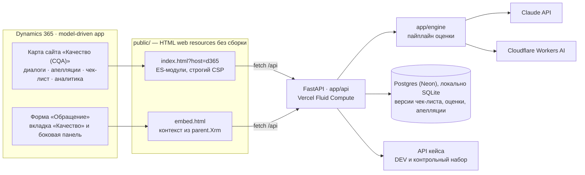

## Запуск

Нужны Python 3.12+ и [uv](https://docs.astral.sh/uv/).

```bash
uv sync
uv run uvicorn app.main:app --port 8000
```

Ключи моделей — в файле `.env` в корне (в git не попадает):

```
ANTHROPIC_API_KEY=...          # Claude; без него ансамбль из открытых моделей
CLOUDFLARE_ACCOUNT_ID=...      # Workers AI
CLOUDFLARE_API_TOKEN=...
```

Одна команда поднимает приложение (http://localhost:8000), оболочку Dynamics 365 (http://localhost:8000/d365/) и API (`/api/*`, Swagger — `/api/docs`). Данные набора бэкенд сам забирает из API кейса по `group_id` (по умолчанию DEV; контрольный набор — ввести его `group_id` в поле «Набор»).

Тесты и линтер (в сеть не ходят):

```bash
uv run pytest
node --test tests/js/*.test.mjs
uv run ruff check app tests
```

Переменные окружения (все необязательные):

| Переменная | По умолчанию | Что задаёт |
|---|---|---|
| `CQA_MODELS` | Claude + GLM-5.3 + Qwen 3.8 (без ключа Claude — DeepSeek + Qwen + GLM) | модели ансамбля через запятую |
| `CQA_RESERVE_MODELS` | DeepSeek → Kimi → Qwen | замена перегруженной модели |
| `CQA_EARLY_STOP` | `1` | не ждать третью модель, если две уже совпали по всем критериям |
| `CQA_PARALLEL_EVALUATIONS` | `2` | одновременных оценок, остальные в очереди |
| `CQA_EVAL_TIMEOUT_SEC` | `90` | таймаут движка на один диалог |
| `CQA_CLAUDE_EFFORT` | `medium` | effort для Claude |
| `CQA_OLLAMA_MODELS` | — | локальные модели Ollama |
| `DATABASE_URL` | — | Postgres; без него — SQLite в `CQA_DB_PATH` (`.data/cqa.sqlite`) |
| `CQA_DB_SCHEMA` | `public` | схема Postgres (например, отдельная для Preview) |
| `CQA_AUTH_USER`, `CQA_AUTH_PASSWORD`, `CQA_SESSION_SECRET` | — | вход для жюри; без `CQA_AUTH_USER` вход выключен |
| `CQA_API_URL` | URL API кейса | базовый URL без `group_id` |
| `CQA_UPSTREAM_TIMEOUT_SEC`, `CQA_CACHE_TTL_SEC` | `90`, `600` | таймаут и кеш API кейса |

Выгрузка набора для анализа: `./scripts/fetch-dataset.sh DEV` (в `data/`, в git не попадает). Деплой на Vercel (Postgres Neon, вход для жюри, переменные окружения) — [docs/DEPLOY.md](docs/DEPLOY.md). Выйти из демо — `/login.html?logout=1`.

## API

Кратко — эндпоинты ниже, подробно — [docs/API.md](docs/API.md), схемы — [docs/CONTRACT.md](docs/CONTRACT.md).

| Запрос | Что делает |
|---|---|
| `GET /api/datasets/{group_id}/conversations` | диалоги набора + сводка последней оценки |
| `GET /api/datasets/{group_id}/conversations/{id}` | диалог; `/audio` — запись звонка с перемоткой |
| `GET /api/checklists`, `GET /api/checklists/{id}?version=N`, `POST /api/checklists/{id}/versions` | версии чек-листа |
| `GET /api/models` | модели и их доступность |
| `POST /api/evaluations`, `GET /api/evaluations`, `GET /api/evaluations/{id}` | оценка диалога и история |
| `POST /api/evaluations/{id}/appeals`, `GET /api/appeals`, `POST /api/appeals/{id}/decision` | апелляции и решения |
| `GET /api/export?format=json\|csv` | экспорт результатов |
| `GET /api/metrics/accuracy`, `GET /api/analytics` | точность против эталона и аналитика |

## Структура репозитория

```
app/engine/          движок оценки: промпты, сигналы, провайдеры моделей, голосование, расчёт итога, метрики
app/api/, app/store/ эндпоинты и хранилище (Postgres или SQLite)
public/              интерфейс (ES-модули без сборки); public/d365 — оболочка Dynamics 365; public/embed.html — панель формы
config/checklists/   исходный чек-лист
eval/                эталон (gold.json), разбиение (split.json), правила разметки (RUBRIC.md, DECISIONS.md), прогоны (runs/)
docs/                задание, фичи, контракт, API, деплой, контрольный прогон, медиа и графики
scripts/             выгрузка набора, прогон точности, перенос данных в Postgres
tests/               pytest и node-тесты
```

## Команда Bolme

- Sabyrzhan — [@sabr2007](https://github.com/sabr2007)
- Alinazar — [@Alinazavrr](https://github.com/Alinazavrr)
- Aliakbar Murat — [@enstrong](https://github.com/enstrong)
